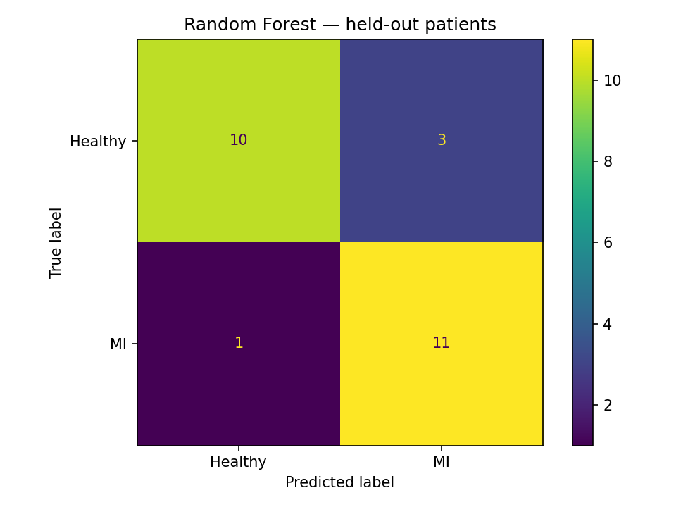
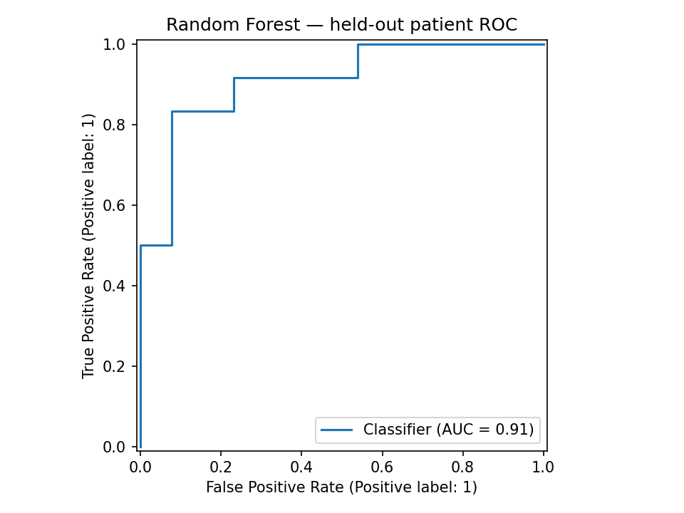
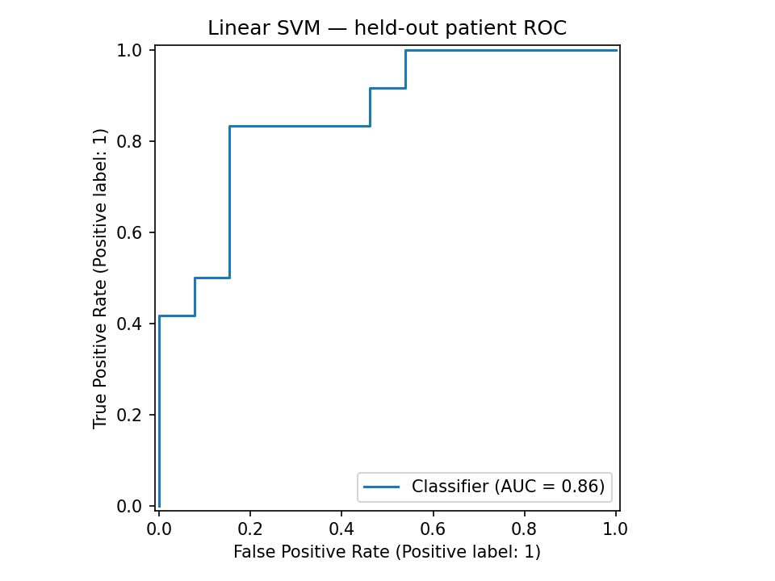
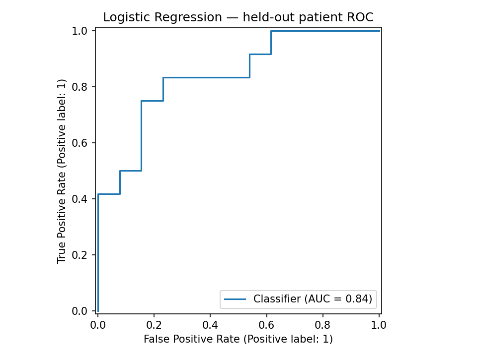

# ECG-Based Myocardial Infarction Classification Using Machine Learning

## Project Overview

This project explores the application of machine learning to ECG signal analysis for distinguishing myocardial infarction (MI) observations from healthy controls.

Originally developed in 2024 as part of my Master of Predictive Analytics at Curtin University, the project was revisited to improve the model evaluation methodology, particularly by preventing patient overlap between training and testing.

## Dataset

The project uses ECG features extracted from the PTB recordings used in the original academic work.

- 100 patients: 50 MI and 50 healthy controls
- 29,737 extracted ECG observations before the revised modelling pipeline
- Four features: RR interval, heart rate, QRS duration and QT interval

The original university experiment used a separately processed and normalised dataset. The revised analysis uses the original extracted, unscaled features.

## Tools and Technologies

- Python
- Pandas and NumPy
- Scikit-learn
- SciPy and PyWavelets (original signal processing)
- Matplotlib and Seaborn

## Methodology

### Original University Analysis (2024)

The original workflow included ECG signal filtering, feature extraction, outlier removal, per-patient normalisation and classification using three machine learning algorithms.

| Model | Accuracy | ROC-AUC |
|---|---:|---:|
| Random Forest | 86.1% | 0.931 |
| Support Vector Machine | 75.1% | 0.816 |
| Logistic Regression | 66.9% | 0.727 |

The original experiment randomly split ECG observations. This allowed data from the same patient to appear in both training and testing, potentially overestimating performance on unseen patients.

### Improved Evaluation (2026)

The revised analysis:

1. Uses extracted ECG features before per-patient normalisation.
2. Separates training and testing patients.
3. Applies required imputation and scaling using training data only.
4. Compares Random Forest, Linear SVM and Logistic Regression.
5. Evaluates predictions at both observation and patient level.

### Improved Results

The following results were obtained from one patient-separated train/test split.

| Model | Observation Accuracy | Patient Accuracy | Patient ROC-AUC |
|---|---:|---:|---:|
| Random Forest | 68.0% | 84.0% | 0.910 |
| Linear SVM | 62.6% | 60.0% | 0.859 |
| Logistic Regression | 62.3% | 64.0% | 0.840 |

The Random Forest model correctly classified 21 of the 25 held-out patients in this particular split.

The revised Linear SVM differs from the original kernel SVM, so their results should not be treated as a direct comparison.

## Model Visualisations

### Random Forest — Patient-Level Confusion Matrix



### Random Forest — Patient-Level ROC Curve



### Linear SVM — Patient-Level ROC Curve



### Logistic Regression — Patient-Level ROC Curve



Additional confusion matrices and detailed model results are available in the `results` folder.

## Key Findings

- Random Forest achieved the highest patient-level accuracy in the revised experiment.
- The evaluation method substantially changed the interpretation of model performance.
- Separating patients helps assess whether models generalise to previously unseen subjects.
- Patient-level metrics are important when multiple observations are extracted from each patient.

## Limitations

- The revised results come from one patient-separated split, rather than repeated cross-validation.
- The extracted ECG features have not been independently validated against clinical annotations.
- The patient-level predictions are based on aggregating observation scores.
- The original and revised experiments differ in preprocessing and, for SVM, model configuration.
- The results cannot establish clinical diagnostic accuracy.

Further work could include grouped cross-validation, feature validation, hyperparameter tuning and external evaluation.

## Project Structure

- `data/` — Original processed and revised unscaled feature datasets
- `src/Modelling.py` — Original university modelling code
- `src/improved_modelling.py` — Revised patient-separated analysis
- `results/` — Model metrics and visualisations
- `requirements.txt` — Python dependencies

## Running the Analysis

Install dependencies:

```bash
pip install -r requirements.txt
```

The improved script uses the two original extracted-feature archives in `data/raw/`. These source archives must be present to regenerate the combined dataset and results.

Run:

```bash
python src/improved_modelling.py
```

## Disclaimer

This is an academic machine-learning project intended to demonstrate data analysis, preprocessing and model evaluation. It is not a clinically validated diagnostic system and must not be used for medical decisions.
